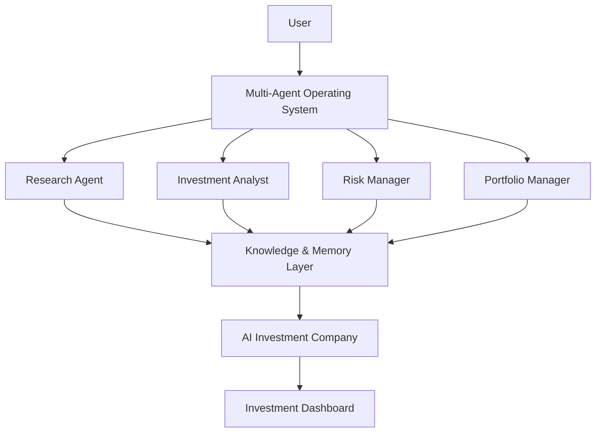

# Multi-Agent Operating System

> A modular AI Operating System for autonomous AI agent orchestration.

---

## 🎯 Project Vision

Multi-Agent Operating System (MAOS) is a personal AI engineering project focused on building a modular operating system where multiple AI agents collaborate to solve complex tasks.

Rather than creating a single AI assistant, MAOS provides a reusable architecture that supports different AI-powered applications.

The first application built on this platform is **AI Investment Company**, an autonomous investment research system designed to automate research, analysis, reporting and investment decision support.

---

## 🚀 Current Development Stage

Current Version: **V1.1 – First Executable Research Agent**

- **V1.0** (tagged `v1.0.0`): system architecture and agent specifications
- **V1.1**: the Research Agent runs from the command line
- **Next:** V1.2 – Multi-Agent Workflow (planned)

Status: 🟢 Active Development

---

## 📌 Project Goals

- Build a reusable Multi-Agent Operating System
- Design specialised AI agents with clear responsibilities
- Develop autonomous investment research workflows
- Integrate Python automation and AI APIs
- Deploy a production-ready AI engineering portfolio

---

## 🏗️ System Architecture



This diagram shows the target architecture. Only the Research Agent is
implemented so far; the other components are planned.

---

## 🤖 AI Agents

Each agent has a written specification (system prompt) in
[`docs/prompts/`](docs/prompts/), created in V1.0.

| Agent | Specification | Status |
|---|---|---|
| Research Agent | [research-agent.md](docs/prompts/research-agent.md) | ✅ Executable (V1.1) |
| Investment Analyst | [investment-analyst.md](docs/prompts/investment-analyst.md) | Specification only |
| Risk Manager | [risk-manager.md](docs/prompts/risk-manager.md) | Specification only |
| Portfolio Manager | [portfolio-manager.md](docs/prompts/portfolio-manager.md) | Specification only |
| Market Monitor | [market-monitor.md](docs/prompts/market-monitor.md) | Specification only |
| Report Generator | [report-generator.md](docs/prompts/report-generator.md) | Specification only |

---

## 📈 Applications

### AI Investment Company

The first working piece is the **Research Agent**. You give it a research
request (optionally a company or market, topic, and time period), and it
returns a structured Markdown report that separates facts from
interpretations.

> **Limitation:** V1.1 has no live web search or market data. The agent
> answers from its model knowledge only, which may be out of date, and any
> sources it lists are unverified suggestions. Do not use its output as
> current market data or investment advice.

---

## 🛠️ Technology Stack

**Requirements:** Python 3.10 or later, and an OpenAI API key to run the agent.

**Runtime dependencies** (installed with the package):

- [OpenAI Agents SDK](https://github.com/openai/openai-agents-python) (`openai-agents` 0.23.1)
- OpenAI Python SDK (`openai` 3.33.0)
- `python-dotenv` 1.2.4, for loading the API key from a local `.env` file

**Development dependencies** (installed with the `dev` extra):

- `pytest` 9.1.1, for the offline test suite

All versions are pinned in [`pyproject.toml`](pyproject.toml).

---

## ⚡ Quick Start

Check your Python version first with `python3 --version`. It must be 3.10
or later. The `python3` that ships with macOS may be older; if so, install a
newer Python from [python.org](https://www.python.org/downloads/) or
Homebrew.

From the repository root:

```bash
python3 -m venv .venv
source .venv/bin/activate
pip install -e ".[dev]" -c constraints.txt

cp .env.example .env   # then put your OpenAI API key in .env

maos-research "Give an overview of the global semiconductor industry"
```

Each run makes a real API call and uses API credit. To run the offline
tests (no API key or network needed), run `pytest`.

See the [Research Agent Setup Guide](docs/v1.1/research-agent-setup.md)
for configuration, all command options, API key safety, and
troubleshooting.

---

## 🗺️ Roadmap

| Version | Focus | Status |
|---|---|---|
| V1.1 | First executable Research Agent | ✅ Done |
| V1.2 | Multi-Agent Workflow | Planned |
| V1.3 | Tools and APIs | Planned |
| V1.4 | MCP | Planned |
